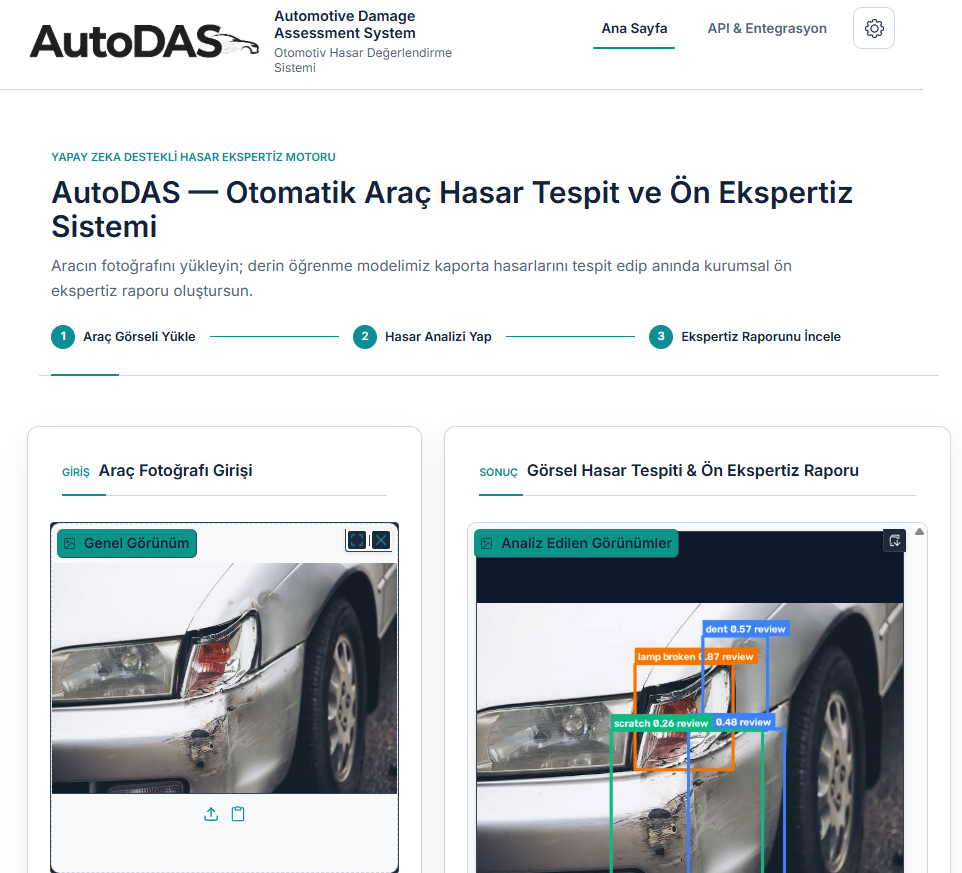

# Auto DAS — Vehicle Damage Detection Prototype

Auto DAS is a computer vision prototype developed during my software engineering internship. It analyzes vehicle photos to identify potential damage and produces a preliminary assessment for human review.

## Demo

*Prototype output; detections require manual verification. Vehicle photo: jcomp / Freepik, via [Carro](https://carro.co/my/blog/4-common-damage-areas).*

## Features

- Switch the interface between Turkish, English, German, French, Spanish, and Arabic
- Use the interface in light or dark theme
- Upload vehicle photos and run YOLO-based damage detection
- View potential damage areas, labels, and confidence scores on the image
- Group overlapping detections in the preliminary assessment
- Review risk summaries, suggested actions, and image-quality warnings
- Download a preliminary assessment as a PDF
- Generate the PDF in the language currently selected in the interface

## Technologies

Python · PyTorch · YOLO · Gradio · ReportLab

## Limitations

Auto DAS is an educational prototype, not a production-ready inspection or insurance decision system. Model predictions, risk summaries, and repair suggestions require verification by a qualified person, especially when confidence is low or the photo does not show the vehicle clearly.

The source code, model weights, and dataset are not published in this showcase repository.
